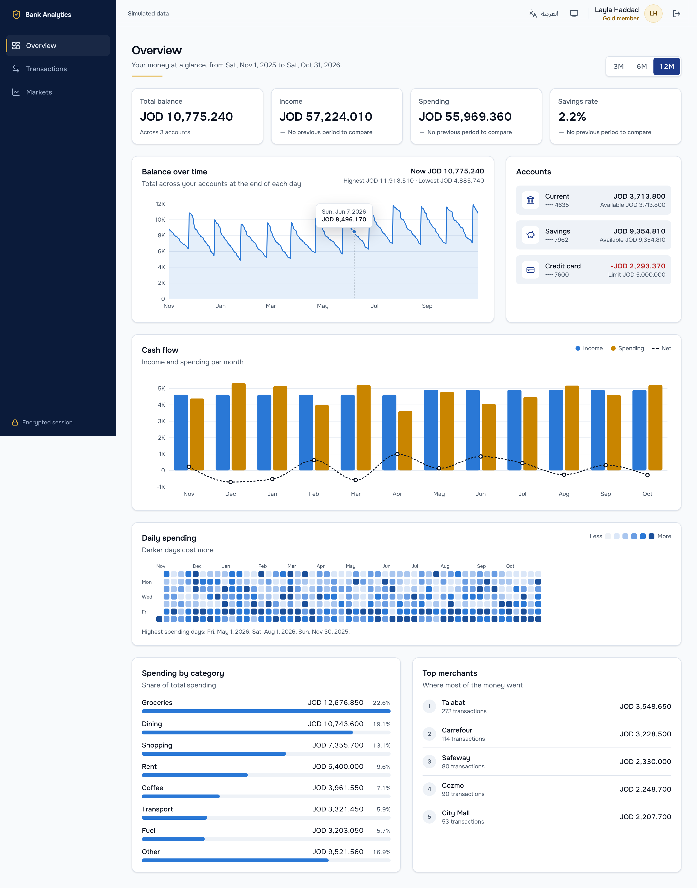
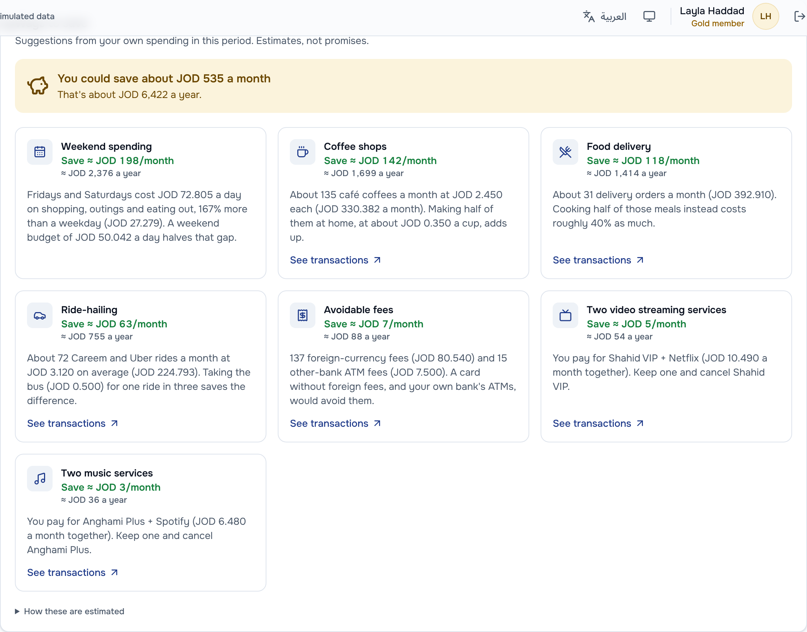
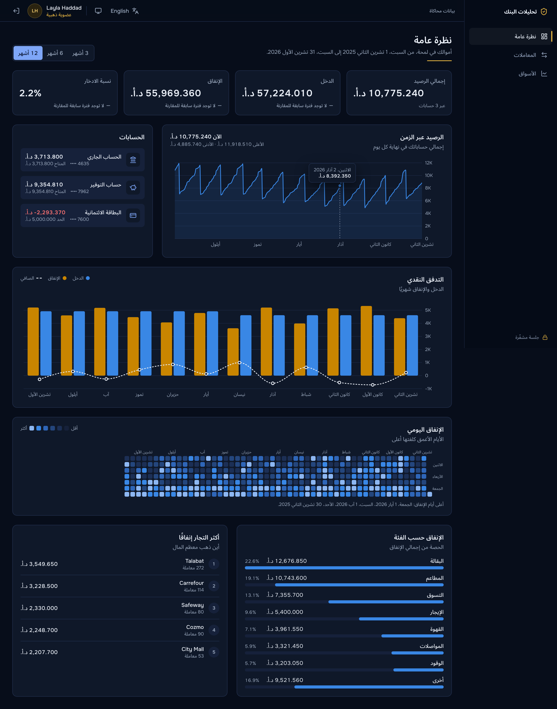
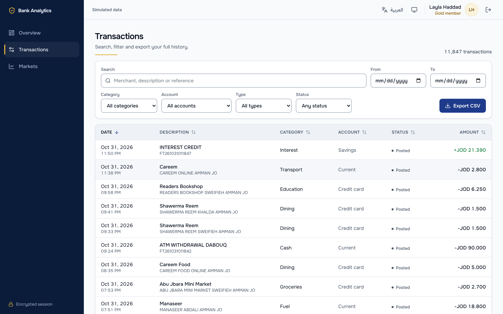
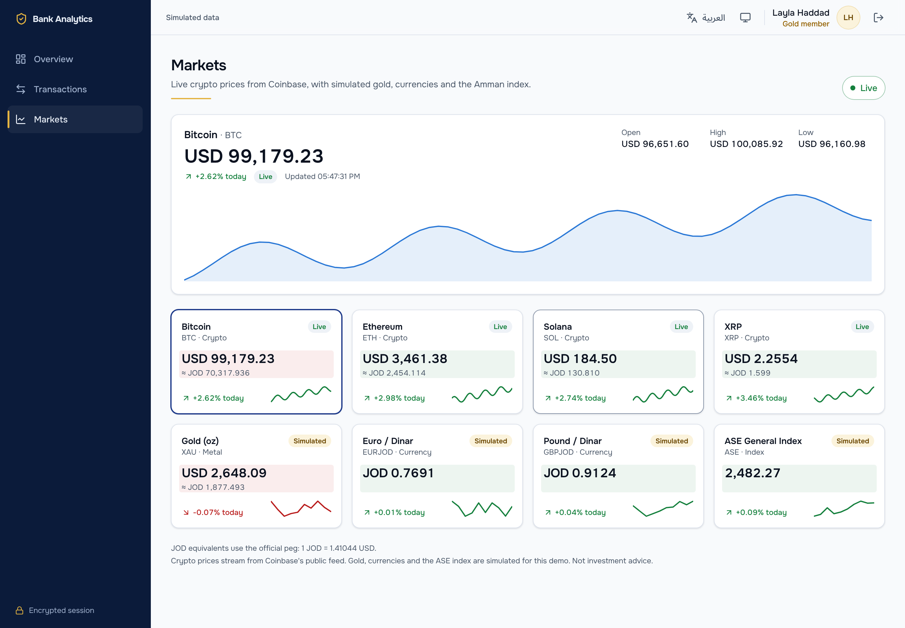
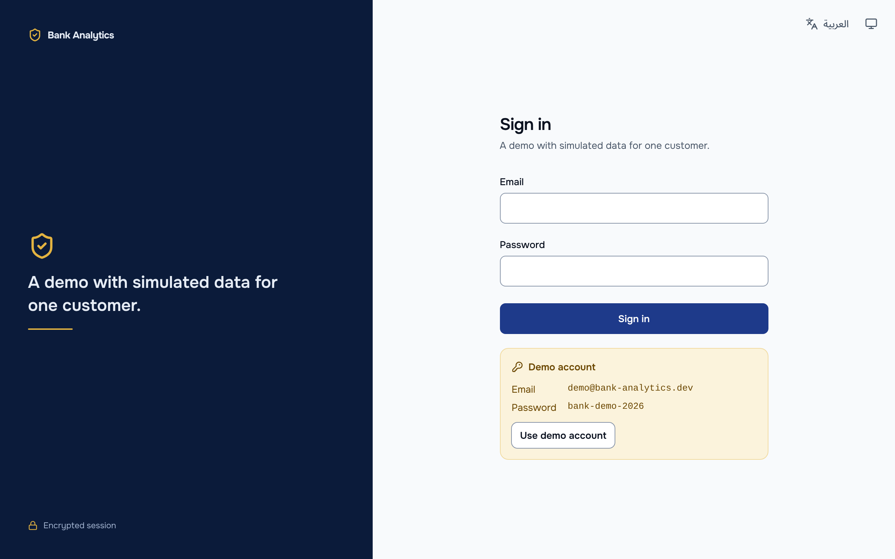
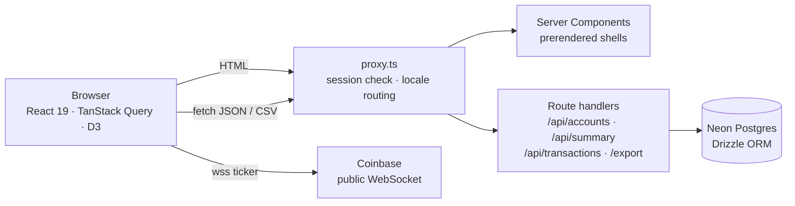

# Bank Analytics Dashboard

A retail-banking analytics app for a simulated Jordanian customer: an overview dashboard with D3
charts, an explorer for 11,800+ transactions, and live market prices over WebSockets. English and
Arabic (right-to-left), light and dark, keyboard- and screen-reader-accessible.

**Live demo:** [analytics-dashboard-nader.netlify.app](https://analytics-dashboard-nader.netlify.app) · sign in with the demo account shown on the sign-in page.



## Features

- **Overview dashboard.** KPI tiles compared with the previous period, a balance-over-time area
  chart with a crosshair, monthly cash flow (income, spending and net), a calendar heatmap of
  daily spending, spending by category, top merchants and accounts. Every chart is D3.
- **Ways to save.** Suggestions computed from the customer's own transactions (overlapping
  subscriptions, café coffee, food delivery, ride-hailing, avoidable fees, weekend spending),
  each with its evidence, an estimated monthly and yearly saving, and a link that opens the
  explorer filtered to the transactions behind it.



- **Transactions explorer.** Server-side search, filters and sorting over the full history,
  rendered with a virtualised table (about 25 DOM rows for 11,847 transactions) and loaded 100
  rows at a time as you scroll. Every filter lives in the URL, so views can be shared and survive
  a reload. CSV export streams every matching row.
- **Live markets.** Crypto prices from Coinbase's public WebSocket feed through a reusable
  `useWebSocket` hook (backoff with jitter, retry budget, pause when hidden), with a simulated
  fallback so the page never goes blank. Gold, currencies and the Amman index are simulated and
  labelled as such.
- **Authentication.** Credentials sign-in with Auth.js, encrypted JWT session cookie, every page
  and API route protected twice (proxy and handler), open-redirect protection on callbacks.
- **Internationalisation.** English and Arabic with full RTL: layout uses logical CSS properties
  only (enforced by a test), charts mirror, amounts keep Latin digits.

|                              Arabic, dark                              |                        Transactions                         |
| :--------------------------------------------------------------------: | :---------------------------------------------------------: |
|  |  |
|                              **Markets**                               |                         **Sign in**                         |
|                           |                     |

## Tech stack

| Area        | Choice                                                                        |
| ----------- | ----------------------------------------------------------------------------- |
| Framework   | Next.js 16 (App Router, Server Components, Partial Prerendering), React 19    |
| Language    | TypeScript (strict, `noUncheckedIndexedAccess`)                               |
| Styling     | Tailwind CSS v4 with design tokens (light/dark), Onest + Noto Sans Arabic     |
| Data        | Postgres on Neon, Drizzle ORM, zod-validated REST API                         |
| Client data | TanStack Query (infinite queries), TanStack Table + Virtual, URL state        |
| Charts      | D3 (scales, axes, shapes, time, transitions)                                  |
| Real-time   | WebSockets (Coinbase public feed) with a custom reconnecting hook             |
| Auth        | Auth.js (credentials, JWT sessions)                                           |
| i18n        | next-intl, English and Arabic (RTL)                                           |
| Testing     | Vitest + Testing Library (212 tests), Playwright (36 tests, incl. axe audits) |
| CI/CD       | GitHub Actions (typecheck, lint, format, unit, end-to-end), Netlify           |

## Architecture



- **Server does the heavy lifting.** Filtering, sorting, pagination and aggregation run in
  Postgres; the browser renders. The API contract (zod schemas and response types in
  `src/lib/api`) is shared by server and client.
- **Pages prerender.** With Cache Components, every page ships a static shell; session-dependent
  parts stream in behind `<Suspense>`.
- **Defence in depth.** The proxy rejects anonymous requests, and every route handler and page
  checks the session again.

```
src/
  app/              routes only: [locale] pages, API route handlers
  features/         overview, transactions, markets, auth (components, queries, logic)
  components/       app shell, theme, providers
  hooks/            useWebSocket, backoff
  lib/              shared, client-safe: API contract, formatting, dates, money, CSV
  server/           server-only: auth, database, queries, env
  i18n/             routing, messages (en, ar)
  styles/tokens.css design tokens
e2e/                Playwright specs
docs/DECISIONS.md   architecture decision log
```

## Engineering decisions

The full reasoning is in [docs/DECISIONS.md](docs/DECISIONS.md). Highlights:

- **Money as integer minor units** (JOD has 3 decimals) end to end; formatting only at the edge.
- **Locale in the URL** (`/en`, `/ar`) so pages stay statically prerenderable.
- **The proxy only reads the session**, never re-issues it, which fixes a race where a request
  in flight during sign-out could sign the user back in.
- **Virtualisation with real table semantics:** `aria-rowcount`, `aria-rowindex` and `aria-sort`
  on a virtualised grid.
- **Comparisons only when meaningful:** KPI deltas are hidden when the previous period starts
  before the account history, instead of showing "+106%".
- **Chart colours validated** for colour-blind separation and contrast in both themes.

## Quality

| Page         | Performance | Accessibility | Best Practices | SEO |
| ------------ | :---------: | :-----------: | :------------: | :-: |
| Sign in      |     100     |      100      |      100       | 100 |
| Overview     |     99      |      100      |      100       | 100 |
| Transactions |     100     |      100      |      100       | 100 |
| Markets      |     100     |      100      |      100       | 100 |

Lighthouse 12, desktop, production build. LCP 0.7–0.9 s, total blocking time ≤ 40 ms, CLS ≈ 0.

- **Accessibility:** axe (WCAG 2.1 AA) on every page in both languages and themes, in CI.
- **Security:** CSP and security headers on every response; CI fails on any CSP violation.
- **Tests:** unit tests for SQL builders, money and date maths, URL state, the WebSocket hook
  (fake socket and timers), D3 chart output; end-to-end tests for auth, the explorer, CSV
  export, live and fallback market feeds, RTL layout and themes.

## Getting started

Requirements: Node.js 22+ and a Postgres 16+ database (Neon or local).

1. Copy `.env.example` to `.env.local` and fill in `DATABASE_URL`, `DATABASE_URL_UNPOOLED`,
   `AUTH_SECRET` (`npx auth secret` prints one) and `DEMO_USER_PASSWORD`.
2. Create the tables and load the demo customer:

   ```bash
   npm install
   npm run db:migrate
   npm run db:seed
   ```

3. Start the app with `npm run dev` and open http://localhost:3000.

| Command             | What it does                                           |
| ------------------- | ------------------------------------------------------ |
| `npm run dev`       | Development server on http://localhost:3000            |
| `npm run build`     | Production build                                       |
| `npm run typecheck` | Route types, then `tsc --noEmit`                       |
| `npm run lint`      | ESLint, zero warnings allowed                          |
| `npm run format`    | Prettier (`format:check` to verify only)               |
| `npm test`          | Unit and component tests (Vitest)                      |
| `npm run test:e2e`  | End-to-end tests (Playwright; needs a seeded database) |
| `npm run db:seed`   | Replace all data with the deterministic demo customer  |

## API

All endpoints return JSON (except the CSV export) and need a signed-in session; without one they
return `401`. Money is in minor units and dates are local days in Amman time.

| Endpoint                       | Purpose                                                                    |
| ------------------------------ | -------------------------------------------------------------------------- |
| `GET /api/accounts`            | Accounts with derived balance and available funds                          |
| `GET /api/summary?months=`     | KPIs, balance history, cash flow, categories, daily spending               |
| `GET /api/transactions`        | Paginated, sortable, filterable list (`src/lib/api/transactions-query.ts`) |
| `GET /api/transactions/export` | CSV of every row matching the same filters (streamed)                      |
| `GET /api/transactions/{id}`   | One transaction with linked refunds or the other leg of a transfer         |

## Deploying to Netlify

`netlify.toml` configures the build and the Next.js adapter. In Netlify, import the repository,
then add `DATABASE_URL` (pooled Neon URL), `AUTH_SECRET`, `DEMO_USER_PASSWORD` and, optionally,
`DEMO_USER_EMAIL` under **Site configuration → Environment variables**, and deploy.

## Data

The demo customer is simulated, not real: a deterministic generator produces 18 months of
salary, rent, bills, card spending at Jordanian merchants, transfers, refunds and declines, with
running balances and a card credit limit. Market prices for gold, currencies and the Amman index
are simulated.
